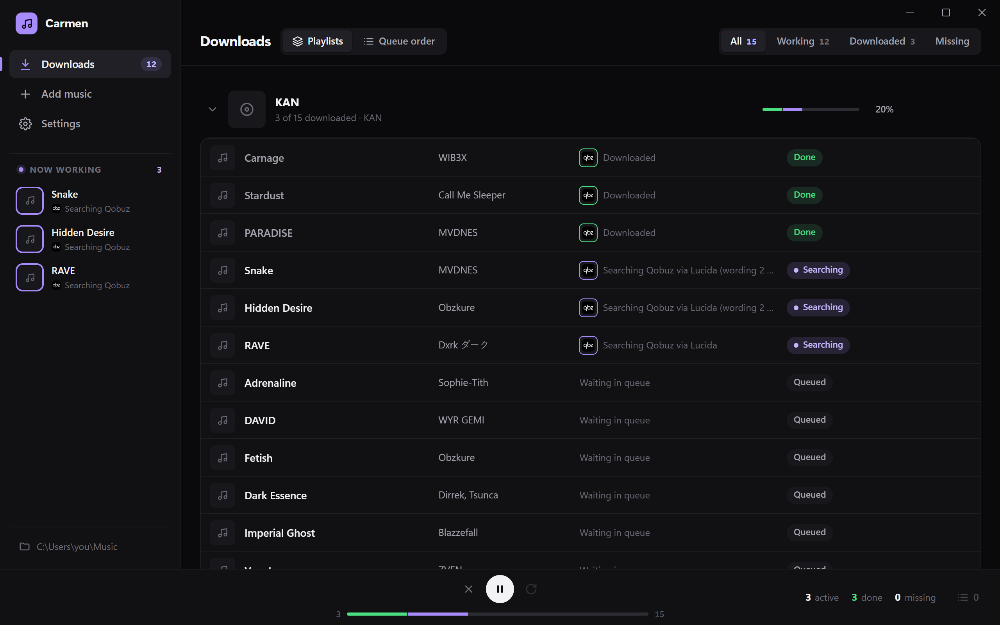
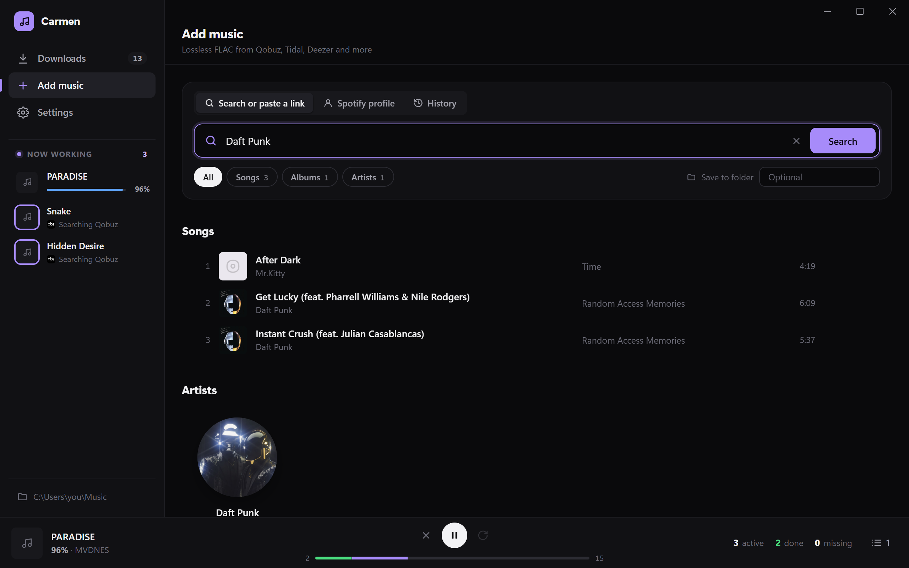
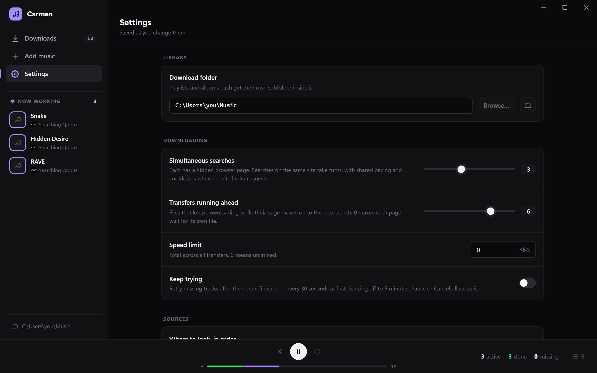
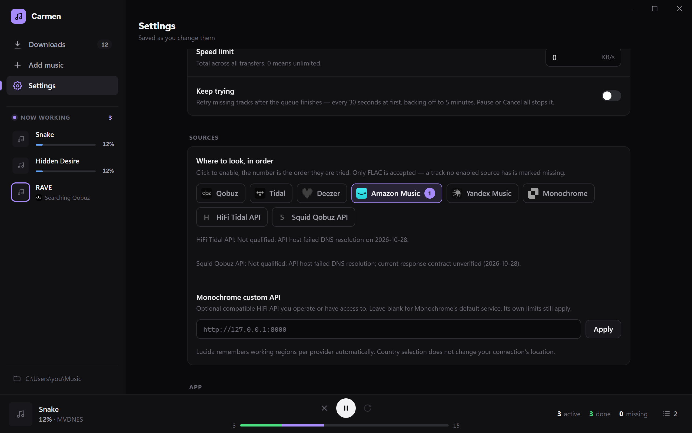
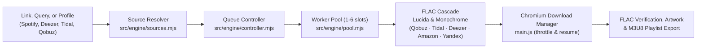

<div align="center">


# Carmen

**Automated lossless FLAC audio fetcher and music library organizer for Windows.**

<p>
  <a href="https://github.com/projectGloria/Carmen/actions/workflows/ci.yml"></a>
  <a href="LICENSE"></a>
  
  
  
</p>

<p>
  <a href="#about">About</a> ·
  <a href="#features">Features</a> ·
  <a href="#screenshots">Screenshots</a> ·
  <a href="#how-it-works">How it works</a> ·
  <a href="#installation">Installation</a> ·
  <a href="#usage">Usage</a> ·
  <a href="#building-from-source">Building from source</a> ·
  <a href="#license--credits">License</a>
</p>

</div>

<p align="center">
  
  <br /><em>Downloads view: live playlist progress, per-track provider status, sidebar worker activity, and global transport bar.</em>
</p>

## About

Carmen is a Windows desktop application built with Electron, React 19, and Vite that turns pasted music links, search queries, and public Spotify profiles into organized, tagged lossless **FLAC** libraries.

It resolves tracklists from Spotify, Deezer, Tidal, and Qobuz, drives Lucida and Monochrome scraper cascades inside isolated background `<webview>` worker slots, and saves transfers through Chromium's native download manager. Every request runs locally from your machine with no user accounts or external telemetry.

## Features

- **Ordered FLAC source cascade**: Enable and rank download sources (`Qobuz`, `Tidal`, `Deezer`, `Amazon Music`, `Yandex Music`, `Monochrome`). Only lossless FLAC is accepted; if a track is missing or region-locked on one source, Carmen advances to the next.
- **Unified search, link, and profile ingestion**: Search by text or paste a Spotify, Deezer, Tidal, or Qobuz link into one box, or switch to the **Spotify profile** tab to import every public playlist with sorting and cross-playlist deduplication.
- **Isolated worker pool and pipelined transfers**: Run 1–6 simultaneous search workers pinned to sandboxed `<webview>` slots, with up to 8 transfers running ahead while workers move on to the next search.
- **Resilient "Keep trying" retry loop**: Automatically re-attempts missing tracks after the queue finishes (starting every 30 seconds and backing off to 5 minutes), backed by atomic persistence across restarts.
- **Folder organization, artwork embedding, and M3U8 export**: Organizes playlists and albums into sanitized subfolders (handling reserved Windows filenames), verifies FLAC identity, embeds cover artwork, and exports `.m3u8` playlists.
- **Desktop controls and diagnostics**: Set a global speed limit (KB/s), pause/resume/prioritize individual tracks or groups, minimize to the Windows system tray, enable optional completion sounds, and export structured session diagnostics reports.

## Supported services

| Service | Icon | Role | Notes |
| :--- | :---: | :--- | :--- |
| **Spotify** |  | Input resolver | Tracks, albums, playlists, and public user profiles |
| **Deezer** |  | Resolver & FLAC source | Tracks, albums, playlists, artist search, and Lucida FLAC mirror |
| **Qobuz** |  | Resolver & FLAC source | Public track/album/playlist links and Lucida FLAC mirror |
| **Tidal** |  | Resolver & FLAC source | Public track/album/playlist links and Lucida FLAC mirror |
| **Amazon Music** |  | FLAC source | Lossless FLAC mirror via Lucida |
| **Yandex Music** |  | FLAC source | Lossless FLAC mirror via Lucida |
| **Monochrome** |  | FLAC source | Lossless FLAC scraper mirror; supports an optional custom compatible HiFi API URL |

## Screenshots

<p align="center">
  
  <br /><em>Add music: unified search and link bar with song, album, and artist filters, optional target folder, and History / Spotify profile tabs.</em>
</p>

<p align="center">
  
  <br /><em>Settings: download folder, worker concurrency, pipelined transfers, bandwidth cap, and automatic retry controls.</em>
</p>

<p align="center">
  
  <br /><em>Sources: click to enable and order FLAC providers, or point Monochrome at a self-hosted compatible HiFi API.</em>
</p>

## How it works



Carmen separates OS integration, download logic, and UI into three layers:

1. **`main.js`** (Electron main process, CommonJS) owns disk I/O, Chromium `will-download` handling, speed throttling, transfer resume, atomic state persistence, JSONL session logging, diagnostics export, and the Windows system tray.
2. **`src/engine/`** (pure Node ESM) holds the queue state machine, worker pool, fuzzy title/artist/duration matcher, link resolvers, and self-contained cascade scripts — completely decoupled from React and Electron so the core engine is unit-testable in Node.
3. **`src/ui/`** (React 19 + Vite) subscribes to the engine controller via `useSyncExternalStore` and falls back to an in-browser mock controller during UI development (`npm run dev:ui`).

## Installation

### Requirements

- **Windows 10 or Windows 11 (x64)**

### Download

Grab the latest Windows build from [GitHub Releases](https://github.com/projectGloria/Carmen/releases), or package it locally with `npm run dist:win` / `npm run dist:portable`:

- **Installer**: `Carmen-1.0.0-Setup.exe` (NSIS installer with Desktop and Start Menu shortcuts)
- **Portable**: `Carmen-1.0.0-Portable.exe` (standalone executable)

On first run, open **Settings** (`Ctrl+3`) and choose your **Download folder** and enabled **Sources**. Packaged builds store configuration, queue state, history, and session logs under `%APPDATA%\Carmen`.

## Usage

### 1. Download a playlist, album, or track

1. Open **Add music** (`Ctrl+2`).
2. Paste a Spotify, Deezer, Tidal, or Qobuz link (or type a song/artist name) into the search box and press **Enter**.
3. Preview the resolved tracks and add them to the queue. Switch to **Downloads** (`Ctrl+1`) to monitor progress.

### 2. Import a public Spotify profile

1. In **Add music**, select the **Spotify profile** tab.
2. Paste a Spotify profile link or enter a username (or type `user:<username>` in the main search box).
3. Choose a playlist order (newest first, most tracks, alphabetical, etc.) and queue the playlists you want. Shared tracks are deduplicated and each playlist gets its own subfolder and `.m3u8` file.

### 3. Control the queue and retries

- Use the bottom transport bar to pause/resume all transfers or cancel the run.
- Use the **All / Working / Downloaded / Missing** filters in **Downloads** to inspect specific states, or switch between **Playlists** and **Queue order** views.
- Enable **Keep trying** in **Settings** (`Ctrl+3`) to retry missing tracks automatically after the queue finishes.

## Building from source

### Prerequisites

- **Windows 10/11 x64**
- **Node.js** (v20+ recommended) and **npm**
- **ffmpeg** on `PATH` (optional; only required for `npm run test:electron` and `npm run test:packaged`)

### Steps

1. Clone the repository and install dependencies:

   ```powershell
   git clone https://github.com/projectGloria/Carmen.git
   cd Carmen
   npm ci
   ```

2. Run the unit tests and linter:

   ```powershell
   npm test
   npm run lint
   ```

3. Run in development mode:

   ```powershell
   # Option A: Preview the React UI in a browser with mock data (http://localhost:5173)
   npm run dev:ui

   # Option B: Build the renderer bundle and launch Electron
   npm run build:ui
   npm start
   ```

4. Package Windows executables (outputs to `release/`):

   ```powershell
   npm run dist:win       # release/Carmen-1.0.0-Setup.exe
   npm run dist:portable  # release/Carmen-1.0.0-Portable.exe
   npm run pack           # unpacked build in release/win-unpacked/
   ```

## Configuration & troubleshooting

<details>
<summary>Project layout, data locations, and diagnostics</summary>

```text
Carmen/
├── main.js              # Electron main process (IPC, downloads, throttling, tray, persistence)
├── src/
│   ├── engine/          # Pure ESM engine (controller, pool, chain, worker, matching, sources, cascades)
│   └── ui/              # React 19 interface (QueueView, AddView, SettingsView, mock controller)
├── scripts/             # Icon generators, Electron smoke tests, benchmarks
├── test/                # Node unit & regression tests (node:test)
└── build/               # Generated app and tray icons (icon.ico, icon.png, tray.png)
```

- **Runtime data**: Development runs (`npm start`) write `state/` and `logs/` inside the repository root (both are gitignored). Packaged builds store them under `%APPDATA%\Carmen`.
- **Speed limiter auto-disable**: If a download server restarts a transfer when paused (refusing HTTP Range resume), Carmen disables the speed limit for the current session and displays a notice in **Settings**. Restart the app to re-enable it.
- **Diagnostics report**: Open **Settings → Diagnostics** to export a single readable report summarizing session events, source responses, and unfinished tracks, or open the raw JSONL logs folder directly.
- **Electron smoke test**: Run `npm run test:electron` (requires `ffmpeg` on `PATH`) to verify end-to-end Electron behavior against isolated local fixtures.

</details>

## Contributing

See [`CONTRIBUTING.md`](CONTRIBUTING.md) for setup, architecture constraints, and pull request guidelines. Follow [`AGENTS.md`](AGENTS.md) and review [`RELIABILITY.md`](RELIABILITY.md) before changing persistence or retry behavior, and run `npm test` and `npm run lint` before submitting.

## License & credits

Distributed under the **ISC License** — see [`LICENSE`](LICENSE) for details.

- Service icons in `assets/services/` use CC0 path data from [Simple Icons](https://simple-icons.github.io/). Service names and trademarks belong to their respective owners and are used solely to indicate compatibility.
